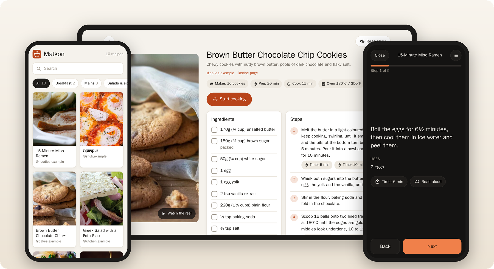
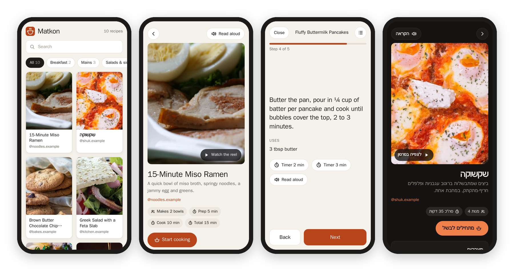
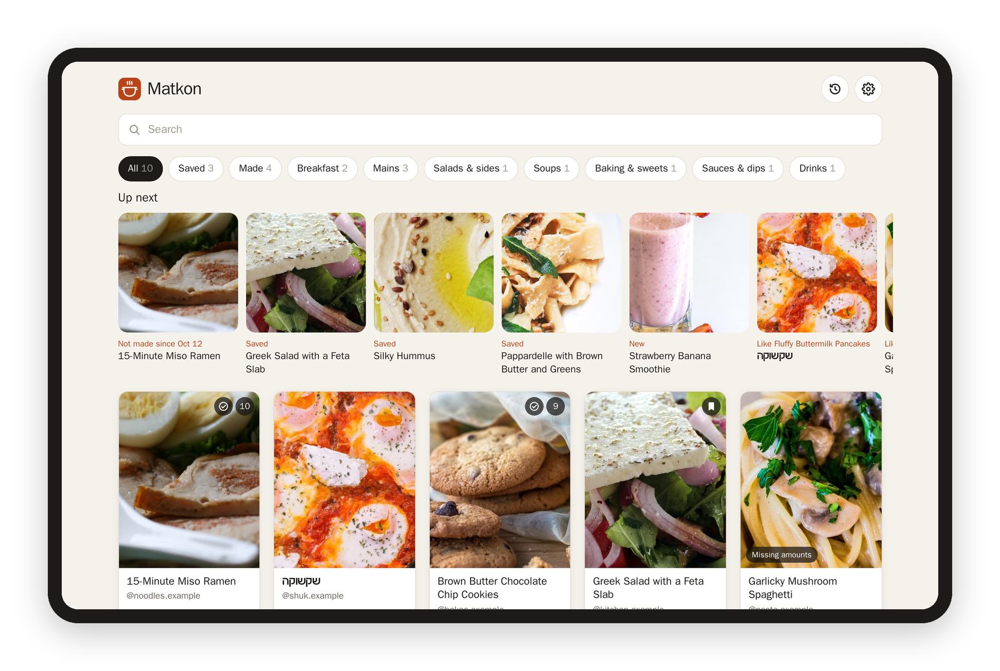
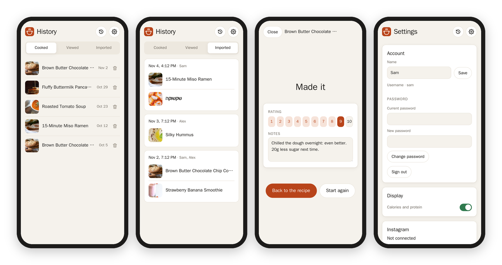
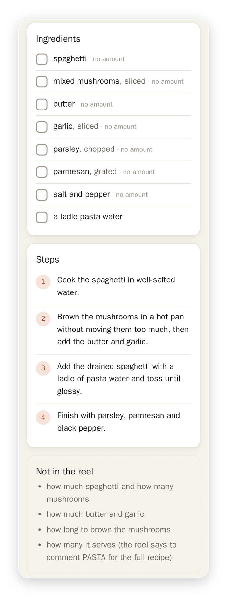
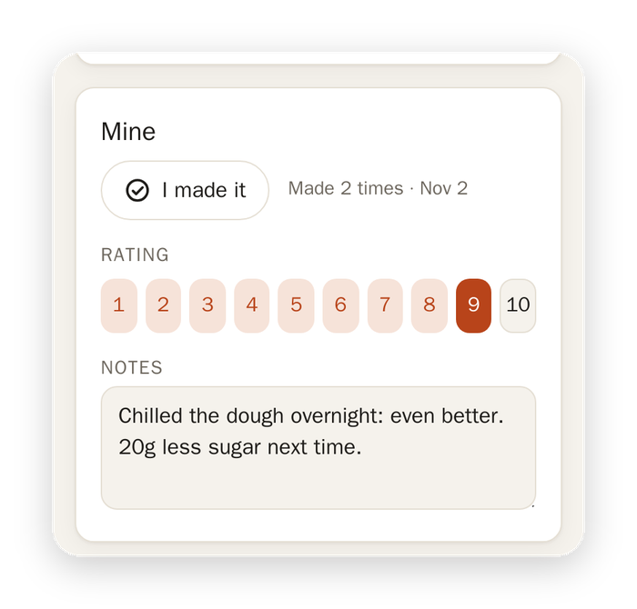
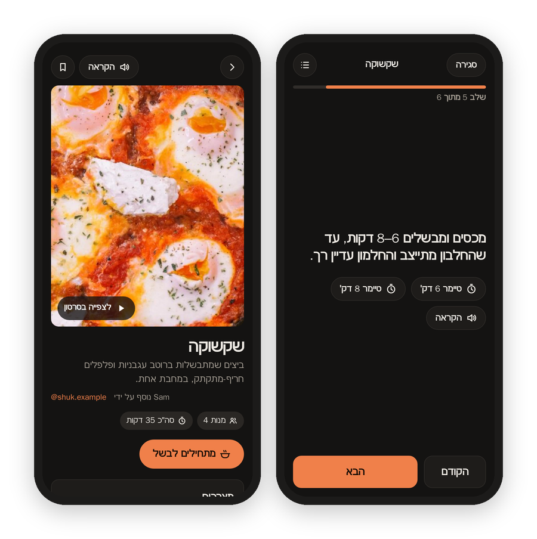
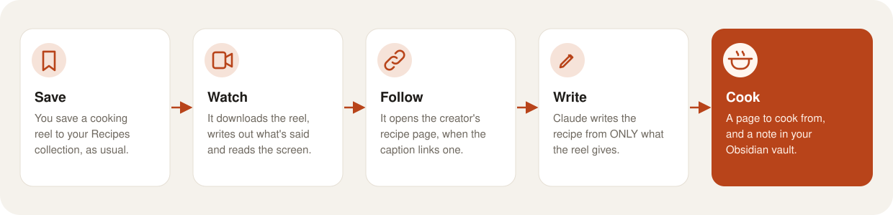

<p align="center">
  
</p>
<h1 align="center">Matkon</h1>
<p align="center"><b>Your saved recipe reels, as recipes you can actually cook from.</b><br>Save a cooking reel on Instagram like you always do, and Matkon turns it into a page with the ingredients, the amounts, the steps and the reel itself.</p>
<p align="center">
  
  
  
  
  
</p>
<p align="center">
  <a href="#why-i-made-it">Why I made it</a> ·
  <a href="#what-it-does">What it does</a> ·
  <a href="#screenshots">Screenshots</a> ·
  <a href="#how-it-works">How it works</a> ·
  <a href="#setting-it-up">Setting it up</a> ·
  <a href="#settings">Settings</a> ·
  <a href="docs/DEVELOPING.md">Developing</a>
</p>



## Why I made it

Matkon (מתכון) is Hebrew for "recipe." I save a LOT of cooking reels to a "Recipes" collection on Instagram, and the recipe is always spread across a fast video, a caption and "comment RECIPE and I'll send it to you." So the collection kept growing, and cooking from it meant rewatching reels and hunting for the amounts.

Matkon does the boring part. It watches the reel, writes out what's said, reads the words on the screen, follows the link to the creator's own recipe page when there is one, and turns all of that into a clean page I can actually cook from, with the reel one tap away. It also leaves a note in my Obsidian vault next to the recipes I already keep there.

## What it does

- **Reads your collection on its own.** Every hour or so it picks up whatever you've saved to your recipe collection, so you never have to send it anything.
- **Only what the reel says.** When a creator doesn't give an amount, the page says "no amount" and lists it under "Not in the reel," instead of guessing. Calories and protein show up only when the reel states them.
- **Finds the real recipe.** When the caption links the creator's blog or newsletter, that's usually where the amounts are, so Matkon reads it. If the link only goes to a Substack's front page, it searches that Substack for the dish.
- **Cooking mode.** One step at a time in big letters, with that step's amounts right under it, timers that keep going if the page reloads, and read-aloud.
- **Search and kinds.** Search by dish, creator or ingredient, and filter by Mains, Baking & sweets, Soups, what you saved and what you've made.
- **Up next.** Matkon learns what you like from what you save, cook and rate, and suggests what to make: the one you saved and never made, the one you rated 10 and haven't made in a month, something like the dishes you keep coming back to.
- **It remembers.** Save a recipe, tap "I made it," rate it 1 to 10, write yourself a note ("20g less sugar next time"). Ticked ingredients and the step you're on are remembered too, on every device, so you can start on the tablet and finish on your phone.
- **History.** What you cooked and when, what you opened lately, and everything Matkon brought in.
- **Accounts.** One kitchen for the whole house: everyone signs in with their own account and keeps their own memory, history and suggestions, and anyone can connect their own Instagram collection to add to it. Each account can also turn calories and protein off.
- **Invites by email.** There's no open sign-up. The owner types someone's email in Settings, Matkon emails them a code, and they open the link (or tap "I have a code") and pick a username and password. Accounts with an email can sign in with it and get a code when they forget their password.
- **Settings in the app.** Connect Instagram and pick the collection, add a single reel by its link, and (for the owner) the kitchen's settings and the accounts.
- **Hebrew too.** Hebrew reels stay in Hebrew, with Hebrew labels, right to left. Reels in any other language come out in English.
- **Obsidian notes.** Every recipe can also be a note with proper front matter, so a Bases view of your recipes lists it. Once you edit a note, it's yours, and Matkon never writes over it.
- **Phone, tablet and computer,** in light and dark mode.

## Screenshots







<table>
  <tr>
    <td width="50%" valign="top">
      
    </td>
    <td width="50%" valign="top">
      <h3>When the reel holds back</h3>
      <p>Plenty of creators keep the amounts for "comment PASTA and I'll DM you." Matkon still writes down everything the reel does show, marks each ingredient that has no amount, and lists what a cook would still need under <b>Not in the reel</b>, so you know exactly what to fill in yourself. It never fills it in for you.</p>
      <h3>Yours</h3>
      
      <h3>Right to left</h3>
      
    </td>
  </tr>
</table>

The pictures come from `tools/demo.py`: made-up recipes by made-up creators and two made-up accounts, with public-domain photos ([credits](tools/demo/CREDITS.md)). They never come from a real collection.

## How it works



For each new reel in the collection, Matkon:

1. downloads the video with yt-dlp, with your own Instagram sign-in (a cookies file),
2. writes out what's said with faster-whisper, on your own machine,
3. takes a frame every second and a half, four to a sheet, so the words on screen can be read,
4. reads the creator's recipe page when the caption links one, taking the page's own recipe data when it has some,
5. hands all of it to Claude through Claude Code, with no tools at all, in one message, and gets the recipe back as JSON,
6. cuts a still of the finished dish for the photo, and writes the Obsidian note.

Every step leaves its file in the reel's folder, so a run that stops halfway picks up where it left off, and `redo` makes any step again.

## Setting it up

You need Python 3.11 or newer, ffmpeg, and [Claude Code](https://claude.com/claude-code) signed in on the same machine.

```bash
git clone https://github.com/franz-rosenzweig/matkon && cd matkon
python3 -m venv .venv && .venv/bin/pip install -r requirements.txt
```

Make a `matkon.env` next to `run.py` (git ignores it) and point it at an Instagram cookies file. Any browser extension that exports cookies.txt will do:

```bash
MATKON_COOKIES=/path/to/instagram-cookies.txt
```

Then find your recipe collection. Instagram doesn't give out collection names anymore, so this lists every collection's id with a few of its captions:

```bash
python3 run.py collections
python3 run.py collection <id> Recipes
python3 run.py sync --full      # the first run looks through ALL your saved posts
python3 run.py serve            # the app, at http://127.0.0.1:8510
```

The first run makes the owner's account (`MATKON_OWNER`, "me" by default) and writes its first password to `initial-password.txt` in the state folder. Sign in with it and change it in Settings, or with `python3 run.py password`. The owner invites everyone else by email, or makes their accounts by hand, in Settings; there's no open sign-up.

For the invites and the forgot-password codes, give Matkon an SMTP server in `mail.json` in the state folder (Proton Mail Bridge on the same machine works):

```json
{"host": "127.0.0.1", "port": 1025, "user": "you@example.com", "pass": "…", "from": "Matkon <support@example.com>"}
```

Without it, an invite shows its code and link for you to pass on yourself.

After that, run `python3 run.py sync` every hour or so (cron is fine). It looks at your newest saves, and once a week at all of them, in case you move an old save into the collection.

| Command | What it does |
| --- | --- |
| `collections` | lists your saved collections, to find the recipes one |
| `collection <id> [name]` | sets which collection to read |
| `sync [--full] [--limit N]` | reads the collection and works through new reels |
| `add <reel link>` | one reel, even one that isn't in the collection |
| `redo <code> [--from STAGE]` | makes it again from `video`, `transcript`, `frames`, `link`, `recipe` or `note` |
| `status` | what's where |
| `password [account]` | sets a new password (the owner's by default) |
| `serve` | the app |

## Settings

Most of it is in the app's Settings page: your name and password, calories and protein on or off, your Instagram sign-in and collection, adding a reel by its link, and, for the owner, "Check now," the kitchen settings below and everyone's accounts.

Under the hood there are two small files. **`matkon.env`**, for where things are:

| Setting | What it's for |
| --- | --- |
| `MATKON_COOKIES` | the Instagram cookies file (the only one you need) |
| `MATKON_STATE` | where the videos, frames and recipes go (`~/.local/share/matkon`) |
| `MATKON_VAULT` | an Obsidian vault for the notes; leave it out for no notes |
| `MATKON_HOSTS`, `MATKON_PORT` | where the app answers (`127.0.0.1`, `8510`); add a private address, like a Tailscale one, to use it from your phone |
| `MATKON_MODEL` | a Claude model, or leave it to Claude Code's default |
| `MATKON_NOTIFY` | a command to tell you about new recipes and a lapsed sign-in: `CMD "Matkon" "message" [now]` |
| `MATKON_PY` | the Python with yt-dlp and faster-whisper, if it isn't `.venv` |
| `MATKON_OWNER` | the owner's username, for the first account |
| `MATKON_MAIL` | where the SMTP settings are, if not `mail.json` in the state folder |

**`settings.json`**, in the state folder, for how the kitchen behaves (the same as the Kitchen part of Settings):

| Setting | Default | What it does |
| --- | --- | --- |
| `collection_id` | | the collection to read (`collection` sets it) |
| `notes_dir`, `photos_dir` | `Recipes`, `Recipes/media` | where the notes and their photos go in the vault |
| `note_tag` | | a tag on its own line above each note's title |
| `app_url` | `http://127.0.0.1:8510` | the app's address, for the link in each note and in invites |
| `scan_pages` | `3` | how many pages of newest saves an hourly run looks at (21 a page) |
| `full_every_hours` | `168` | how often a run looks at every saved post |
| `per_run` | `6` | how many reels a run works through at most |

## A few honest notes

- Matkon reads Instagram the way its own website does, with your own sign-in. That isn't an official API, so it can break when Instagram changes things, and it's kept gentle on purpose: a few pages and a few seconds apart.
- The pages hold other people's videos and recipes, so keep the kitchen to your own people. Everything but the sign-in page needs an account, and if you open it to the internet, do it over HTTPS (a Cloudflare Tunnel works well), so the sign-in cookie stays secure.
- Your notes, ratings and what you cooked go into the owner's Obsidian notes too (front matter `rating`, `cooked`, `last`, and the Notes heading), as long as you haven't rewritten the note yourself.
- The creators did the cooking. Every page links back to the reel and to the creator's own recipe page.

## License

MIT. See [LICENSE](LICENSE). The demo's photos are public domain; see [their credits](tools/demo/CREDITS.md).
