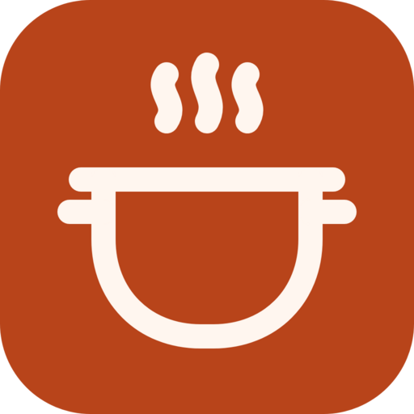

<h1 align="center">Matkon docs</h1>

How Matkon turns saved cooking reels into recipes, and how to cook, remember and share with it.

These pages are how Matkon works, written down. It takes the cooking reels I save on Instagram and turns each one into a recipe I can actually cook from. If something here doesn't match what Matkon does, Matkon wins, and I fix the page.

### Getting started
- [What is Matkon?](what-is-matkon.md): what it does, where you open it, and signing in
- [Accounts and invites](accounts-and-invites.md): joining with an invite, signing in with your email, and a forgotten password
- [Why I made it](../README.md#why-i-made-it): the story, on the front page

### Using it
- [Recipes](recipes.md): the home page, search, a recipe, the reel, and Hebrew or English
- [Cooking](cooking.md): one step at a time, with the amounts, timers and read-aloud
- [Memory and history](memory-and-history.md): saving, "I made it", ratings, notes, Up next, and History
- [The Android app](android-app.md): Matkon on a phone or a tablet, with cook mode, alarm timers, the week and the shopping list
- [The browser extension](browser-extension.md): how your saved reels get from Instagram into Matkon, and setting it up
- [Instagram sign-in on the server](instagram-sign-in.md): the other way, with no browser open, and what it costs
- [Settings](settings.md): your account, what you see, Instagram, adding a reel, and the kitchen

### How it works
- [From reel to recipe](how-it-works.md): every step a reel goes through, and the "only what the reel says" rule
- [Obsidian notes](obsidian-notes.md): the note each recipe gets, and what Matkon will and won't change in it
- [Nextcloud Cookbook](nextcloud-cookbook.md): a copy of every recipe in Cookbook, for its phone apps

### Under the hood
- [Setting it up](../README.md#setting-it-up): the install and the first run, on the front page
- [Developing and running it](DEVELOPING.md): the files, the state folder, the traps, and the pictures

Start with [What is Matkon?](what-is-matkon.md).
