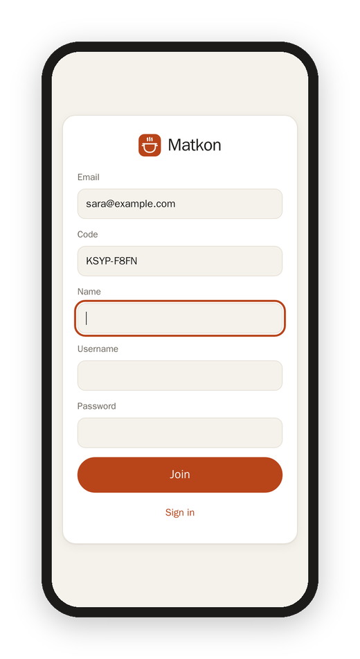

[Matkon docs](README.md) › Getting started

# Accounts and invites

Matkon is one kitchen for a few people. Everyone sees every recipe, and each person has their own account, with their own saved recipes, notes, ratings, history and suggestions. Nobody can sign up on their own: the owner invites them.

## Joining with an invite

When I invite you, you get an email from Matkon with a code like `KSYP-F8FN` and a link.

1. Open the link. Matkon opens with your email and the code already filled in.
2. Add your name, pick a username and a password (at least 8 characters), and tap **Join**.

That's it, you're in. If the link doesn't open, go to Matkon, tap **I have a code**, and type your email and the code yourself. The code works for 7 days, and only once.

## Signing in with your email

You can sign in with your username or with your email, whichever you remember.

## A forgotten password

Tap **Forgot password** on the sign-in page and type your email. Matkon sends a 6-digit code that works for 15 minutes; type it with a new password and you're signed in. This needs an email on your account: if you joined with an invite, you have one, and otherwise you can add it in [Settings](settings.md).

## Inviting someone (the owner)

In **Settings › Accounts › Invite**, type their email and, if you like, their name, and tap **Send invite**. The invite waits in the list until they join, and you can cancel it there. If the email can't go out for some reason, Matkon shows you the code and the link so you can send them yourself.

The owner can also make an account by hand (name, username and password), set a new password for someone, or remove an account.

## Your own Instagram, too

Anyone can connect their own Instagram and pick one of their saved collections, and the reels in it join the kitchen with their name on them ("Added by Sara"). See [Settings](settings.md#instagram).

Next: [Recipes](recipes.md)
