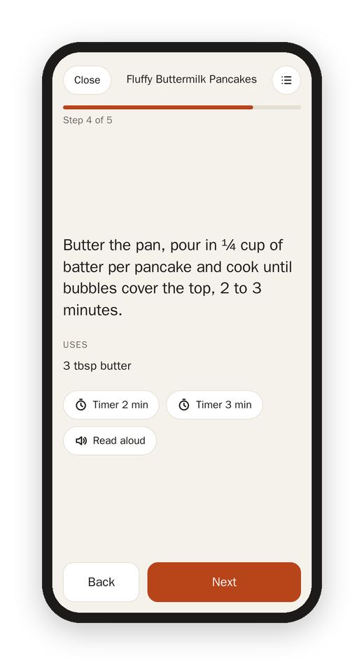

[Matkon docs](README.md) › Using it

# Cooking

**Start cooking** on a recipe opens cooking mode: one step at a time, in big letters, so you can read it from across the counter with flour on your hands.

- **Uses** under each step lists the ingredients that step names, with their amounts, so you don't have to scroll back up to find out how much. If you doubled the recipe under **Amounts**, these are doubled too, and so is the ingredient list.
- **Timers** appear when a step gives a time ("bake 10 to 12 minutes" gives you both). A timer keeps going when you move on, shows at the bottom of every page, and keeps going if the page reloads. When it's done it beeps, buzzes the phone if it can, and puts a big "Time's up" on the screen.
- **Read aloud** reads just that step.
- **The list button** at the top opens the ingredients, to tick them off without leaving the step.
- **Back** and **Next** at the bottom, or the arrow keys and the space bar on a keyboard.
- **The screen stays on** while you cook, on devices that allow it.

Matkon remembers which step you're on for 12 hours, on all your devices. So you can start on the tablet, walk away, and pick it up on your phone at the same step.

## Done

The last step's button is **Done**. It counts it as made today, and then asks how it was: a rating from 1 to 10 and a place for notes ("20g less sugar next time"). Both are optional, and both show on the recipe the next time you open it.

Next: [The week and the shopping list](week-and-list.md)
