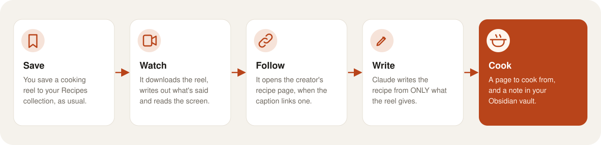
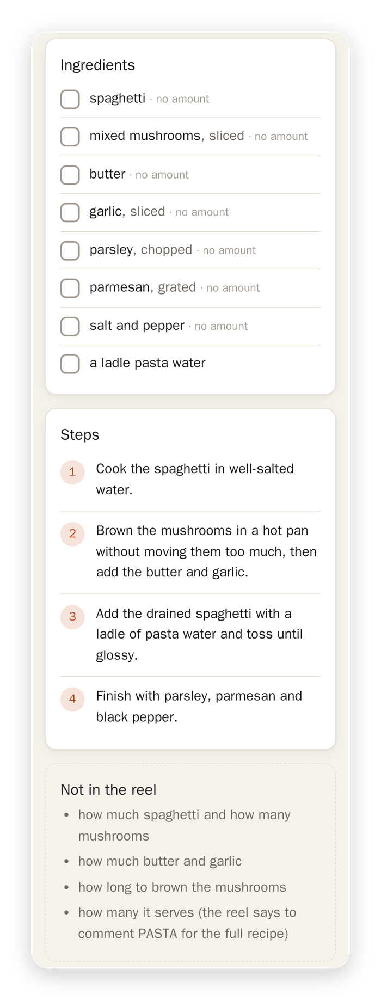

[Matkon docs](README.md) › How it works

# From reel to recipe

The extension in your browser looks at Instagram while you're on instagram.com, and sends each new reel in your recipe collection to Matkon (see [The browser extension](browser-extension.md)). Or, with a sign-in pasted into Settings, the server looks itself, during the day (see [Instagram sign-in on the server](instagram-sign-in.md)). Then the reel goes through these steps, one after the other. Each step leaves its file behind, so if something stops halfway, the next run picks up where it left off.

1. **The video.** The extension sends it (or the server fetches it), the same file Instagram's page plays, right after the post (who made it and the caption). Matkon starts on it the moment it arrives.
2. **What's said.** faster-whisper writes out the speech, on the server itself. A silent reel just skips this.
3. **What's on screen.** A frame every second and a half (32 at most), four to a sheet, so the words the creator puts on screen can be read.
4. **The linked page.** When the caption links the creator's own recipe page ("full recipe on my blog"), Matkon reads it once. Recipe sites usually carry the recipe as data for search engines, with every amount, and Matkon takes that when it's there. A link to a Substack's front page gets a search of that Substack for the dish. A page behind a paywall gives what it gives.
5. **The recipe.** Claude gets the caption, what's said, the frame sheets and the linked page in one message, with no tools at all, and writes the recipe back as data. It also picks the frame where the finished dish fills the picture, which becomes the photo.
6. **The note** in the owner's Obsidian vault. See [Obsidian notes](obsidian-notes.md).
7. **The English version,** when the recipe is in Hebrew. Claude translates it, and Matkon checks that it has the same ingredient groups, ingredients, steps and tips in the same order, and the same timers, before keeping it.

After that, when the owner has set it up, the recipe goes over to Nextcloud Cookbook too. See [Nextcloud Cookbook](nextcloud-cookbook.md).

## Only what the reel says

This is the one rule that matters. Claude is told to use only the caption, the speech, the words on screen, what's plainly shown and the creator's own page, and never to estimate an amount, a time, a temperature or a number of servings.

- An ingredient with no amount says **no amount**.
- **Not in the reel** lists what a cook would still need: "how much spaghetti and how many mushrooms", "how long to brown them".
- A recipe is marked complete only when every ingredient has its amount (or "to taste") and there are steps. Otherwise its card says **Missing amounts**.
- Calories and protein are copied only as the reel states them.
- A reel that isn't a recipe at all (someone showing off their pans, say) is kept out of the list.

Plenty of creators keep the amounts for "comment RECIPE and I'll DM you," so a lot of recipes come out with something missing. Basically, the page tells you exactly what to fill in yourself, instead of quietly making it up.

## Languages

Hebrew reels are written in Hebrew, and get their English version in step 7. Reels in any other language (Turkish, Arabic, Spanish…) come out in English straight away. A dish's own name stays its name: Shakshuka, Pad Kra Pao, Tarte Tatin.

Next: [Obsidian notes](obsidian-notes.md)
