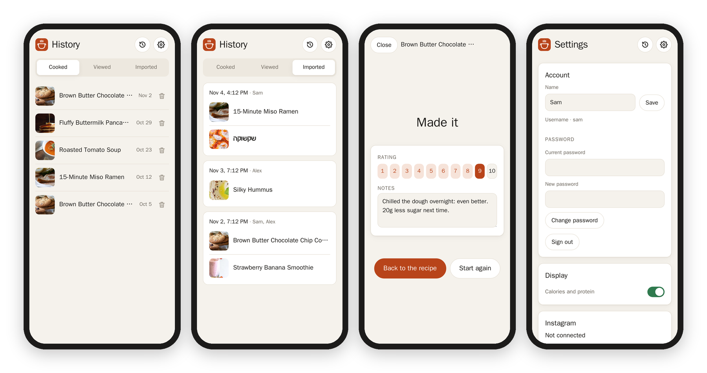
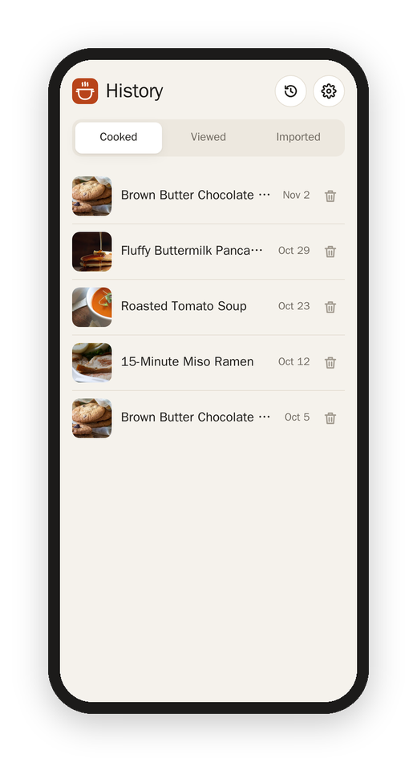

[Matkon docs](README.md) › Using it

# Memory and history

Matkon remembers things for each account, on the server, so your phone, your tablet and your computer all see the same thing.

## What it remembers

- **Saved:** the bookmark at the top of a recipe. Saved recipes have their own kind on the home page.
- **Made:** "I made it" on a recipe (or **Done** at the end of cooking mode) counts it, with the date. "I made it" asks for the amounts you made (½× to 3×) and a note for that time ("too salty", "doubled it for guests"), both optional. The recipe then says "Made 3 times · 2 Nov", lists the times with a note or other amounts, and offers **Again, like last time · 2×** to start cooking at the amounts you used before.
- **Rating:** 1 to 10, under "Mine" on the recipe. Tap the same number again to take it away.
- **Notes:** your own words under "Mine". They save as you type.
- **Ticked ingredients and the step you're on,** for 12 hours, so the next time you cook it starts fresh.
- **What you opened lately.**
- **The week plan and the shopping list.** See [The week and the shopping list](week-and-list.md).

For the owner, the rating, "made" and the notes also go into the recipe's Obsidian note. See [Obsidian notes](obsidian-notes.md).

## Up next

The row at the top of the home page is Matkon's guess at what you'd want to make, from what you've done so far. Each one says why:

- **Saved:** you saved it and never made it.
- **Not made since 12 Oct:** you rated it 8 or more, and it's been a couple of weeks.
- **Like Brown Butter Cookies:** it shares a kind, a cuisine or main ingredients with the ones you rate highly or keep making.
- **New:** it came in during the last 10 days and you haven't opened it.

It leaves out anything you rated 4 or less, and anything you made in the last 5 days. The more you save, cook and rate, the better it gets.

## History

The clock at the top of every page opens History, with three tabs:

- **Cooked:** a calendar of the month with a little photo on every day you cooked (the arrows go back through earlier months), and under it everything you made, newest first, with the date, the amounts and your note. The pencil changes the note, and the bin takes the line away, for the time you tapped "I made it" by mistake.
- **Viewed:** what you opened lately.
- **Imported:** every time Matkon made recipes, with who added them, and anything that went wrong (a reel it couldn't make a recipe from, for one).

Next: [The browser extension](browser-extension.md)
