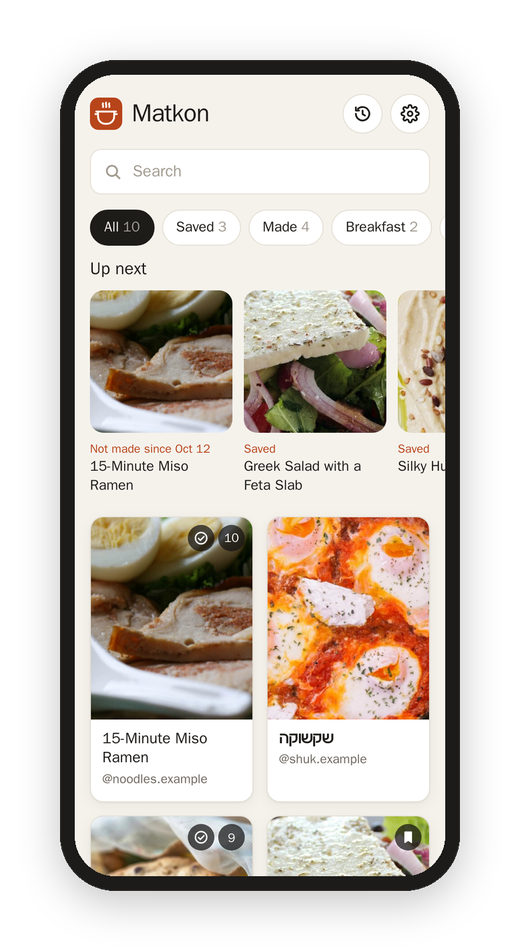
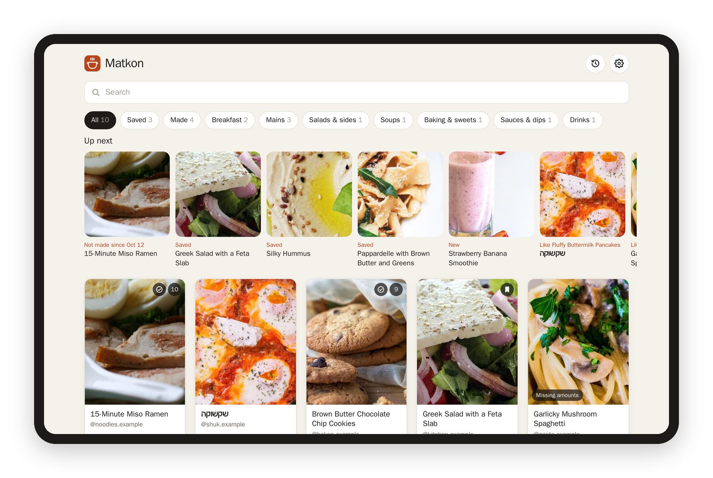
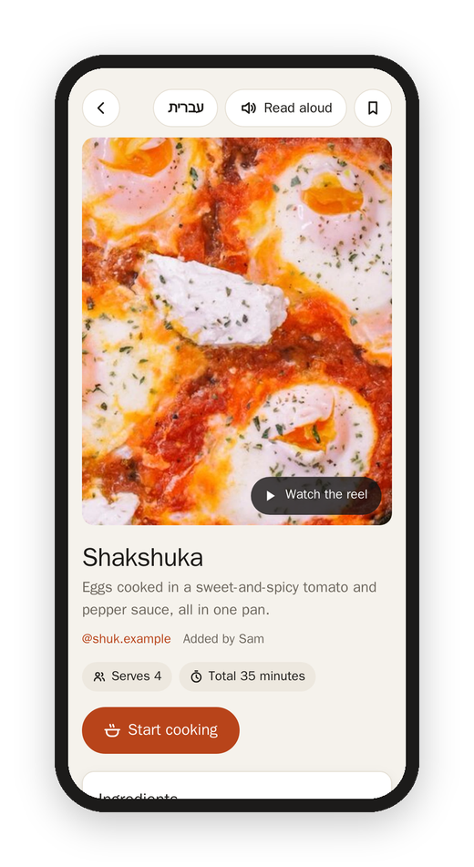

[Matkon docs](README.md) › Using it

# Recipes

## The home page

Every recipe in the kitchen, the newest added first, as cards with the photo, the dish and the creator. A card says **Missing amounts** when the reel didn't give them all, and the little marks on the photo are yours: saved, made, and your rating.

- **Search** looks at the dish, the creator, the cuisine and every ingredient, so "chickpeas" finds the hummus. Hebrew recipes are found by their English words too.
- **The kinds** under the search are All, Saved, Made, and then Breakfast, Mains, Salads & sides, Soups, Bread & dough, Baking & sweets, Snacks, Sauces & dips and Drinks.
- **Up next** is a row of what to make, picked from what you save, cook and rate. See [Memory and history](memory-and-history.md#up-next).
- **Sort and filter** is the button next to the search. **Sort** puts the recipes in the order they came into Matkon (**Added**, the usual), the order they were posted on Instagram (**Posted**, newest first, with each card's date), or **A–Z**. Your pick is remembered on that device. **Creator** lists everyone whose reels are in the kitchen, with how many recipes each, and picking one shows only theirs, with the × next to their name to go back to everyone.

## Dates

Each recipe says when it was **Posted** on Instagram, and when it was **Added** to Matkon (and by whom, when the kitchen has more than one account). Instagram doesn't say when you saved a reel, so Added is the closest Matkon has: a reel comes in within a few hours of being saved, so for anything saved from now on, the day it was added is the day you saved it. The ones that were already in my collection when I set Matkon up all say the day they were brought in.

## A recipe

The top of a recipe has the photo (a still of the finished dish from the reel), the name, a line about what it is, the creator's account (tap it for all their recipes in the kitchen), **Instagram** (the reel itself), their recipe page when there is one, the dates, and the facts the reel gives: how many it serves or makes, the times, the oven.

- **Watch the reel** plays the video right there.
- **Start cooking** opens [cooking mode](cooking.md). If you were in the middle of it, it says **Continue · step 4**.
- **Ingredients** tick off as you tap them, and the ticks are remembered on all your devices for 12 hours.
- **Steps** come with a timer button wherever a step gives a time.
- **Tips** are the creator's own asides.
- **Nutrition** shows only when the reel states it, and only if your account has it on.
- **Not in the reel** lists what a cook would still need that the reel didn't give, like "how much butter and garlic".
- **Mine** is yours: I made it, a rating and notes. See [Memory and history](memory-and-history.md).

On a tablet or a computer, the photo stays on the side and the ingredients and steps sit next to each other.

## Hebrew and English

A Hebrew recipe has a button at the top that says **English**. It switches the whole page to an English version, left to right, and the button turns into **עברית** to switch back. Your ticks, notes and place in the steps stay the same, because the English version has the same ingredients and steps in the same order. Cooking mode follows whichever one you picked.

If you'd rather always read Hebrew recipes in English, turn on **Hebrew recipes in English** in [Settings](settings.md).

## Read aloud

**Read aloud** at the top reads the whole recipe, the ingredients then the steps, in the browser's own voice (a Hebrew voice for a Hebrew recipe, if the device has one).

Next: [Cooking](cooking.md)
