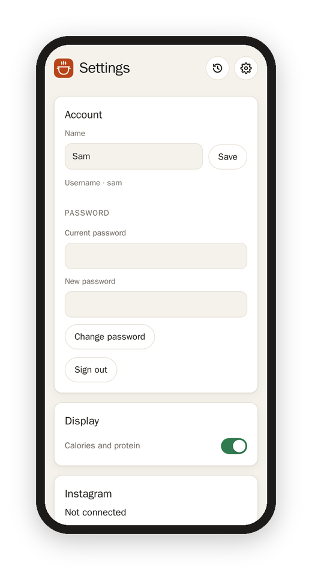

[Matkon docs](README.md) › Using it

# Settings

The gear at the top of every page opens Settings. Everything here is for your own account, except the last two parts, which only the owner sees.

## Account

- **Name:** how you show up to everyone else ("Added by Sara").
- **Email:** for signing in with it and for a forgotten password. A new email gets a 6-digit code first, to make sure it's yours.
- **Password:** your current one, then the new one. Changing it signs this account out on every other device.
- **Sign out.**

## Display

- **Calories and protein:** off means you never see nutrition numbers on any recipe, even when the reel gives them. They're taken out before the recipe even reaches your device.
- **Hebrew recipes in English:** on means Hebrew recipes open in English, and their cards show the English names. The button on each recipe still switches back.

## Instagram

This is how your own saved reels join the kitchen.

1. **Connect:** give Matkon your Instagram sign-in as a `cookies.txt` file, from a browser that's signed in to Instagram. Any extension that exports cookies.txt will do; choose the file or paste what's in it, and tap **Connect**.
2. **Find my collections:** Matkon looks through your saved posts (it takes a minute or two) and lists your collections, each with a few of its captions so you can tell which one is the recipes. Instagram doesn't hand out collection names anymore, which is why it shows captions.
3. **Tap your recipe collection** to pick it. From then on the hourly run reads it with your sign-in, and its reels join the kitchen with your name on them.

If Instagram ever turns the sign-in away, this part says **Sign-in lapsed** and the home page says so too, and nothing new comes in until you connect again.

## Add a reel

Paste the link of any Instagram reel and tap **Add**, even one that isn't in a collection. It shows up in the kitchen a few minutes later.

## Kitchen (the owner)

- **Check now:** reads the collections right away, instead of waiting for the hour.
- **Pages each hour:** how many pages of newest saves an hourly run looks at (21 posts a page).
- **Every save, every (hours):** how often a run looks through every saved post, for an old save moved into a collection (168 is once a week).
- **Reels each run:** how many reels a run works through at most.
- **Notes folder, Photos folder, Note tag:** where the Obsidian notes go, and a tag for them. See [Obsidian notes](obsidian-notes.md).
- **App address:** Matkon's own address, for the link in each note and in invites.

## Accounts (the owner)

Everyone's accounts, with a new password or a bin for each, **Invite** by email, and **New account** by hand. See [Accounts and invites](accounts-and-invites.md).

Next: [From reel to recipe](how-it-works.md)
