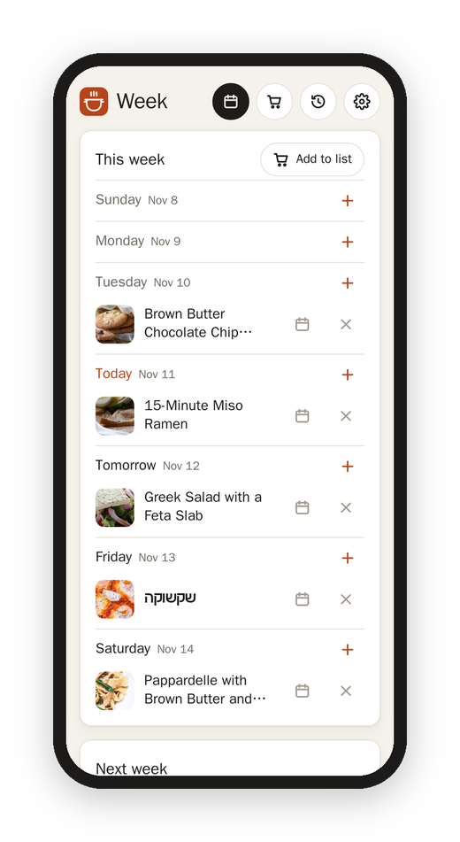
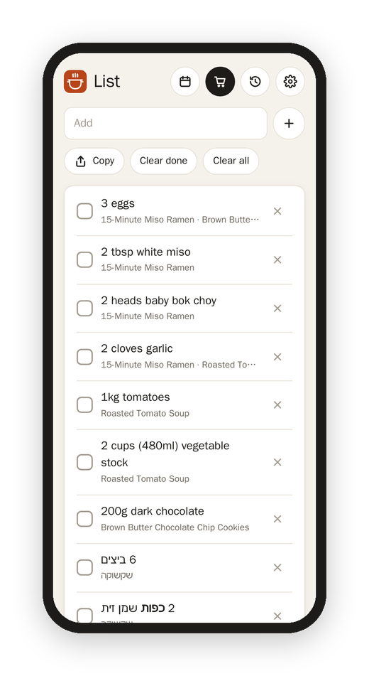

[Matkon docs](README.md) › Using it

# The week and the shopping list

I wanted Matkon to help with the part before the cooking too: deciding what to make this week, and getting what it needs from the store. So there's a week plan and a shopping list, and they're the same ones the [Android app](android-app.md) has. They live on the Matkon server under your account, which means something I plan on the phone shows up in the browser, and an egg I tick off in the store is ticked on the tablet at home.

 

## The week

The calendar button at the top of every page opens **Week**. It shows this week and next, starting on Sunday, with today in orange. The days that already went by stay there in grey, so you can still see what you made on Tuesday. On a tablet on its side, or a computer, the two weeks sit next to each other.

There are two ways to put a recipe on a day. On the recipe itself, **Plan** opens the next two weeks, starting today, and you pick the day. Or on the week, the **+** next to a day opens your recipes, with the saved ones first and a search at the top, and you pick the recipe. Each planned recipe opens with a tap, and the dots on its left drag it to another day (with a mouse, a finger or the pen). The calendar next to it moves it too, and the × takes it off.

**Add to list** next to "This week" puts every recipe planned from today to Saturday onto the shopping list in one go. Basically, plan the week on Sunday, tap it once, and the shopping is written down.

## The shopping list

The cart button at the top of every page opens **List**.

**Add to list** on a recipe puts all of its ingredients on it, at the amounts you're looking at. So if you picked **2×** under **Amounts**, the list gets the doubled amounts. When the same thing comes from more than one recipe, it's ONE line, added up where the units agree: two eggs from the ramen and one from the cookies is "3 eggs," and "1 cup" and "½ cup" of rice is "1½ cups." When they don't agree, like "1 clove" and "1 head" of garlic, the line says both. Under each line are the recipes it came from.

The list sorts itself by aisle: Produce, Bakery, Meat and fish, Dairy and eggs, Frozen, Pantry, Spices, Drinks and Household, in English and Hebrew, so I walk the store once. If Matkon puts something in the wrong aisle, the tag next to it moves it, and it stays there from then on.

Tap a line to tick it off, and it moves down to **Done**. Type at the top to add something that isn't from a recipe, like coffee or paper towels. The × on a line takes it off.

- **Share** sends the list as text to another app, on a phone. On a computer it says **Copy** and puts it on the clipboard instead.
- **Clear done** takes off what you've ticked.
- **Print** prints it, by aisle.
- **Clear all** empties the whole list, after it asks.

## Sharing them

Two or more accounts can share ONE week and ONE shopping list, for a household. The owner sets it up in [Settings](settings.md#week-and-list): pick the accounts and **Share the week and list**. From then on, whatever any of them plans or ticks, they all see, and the Week and List pages say who it's with. Whoever was already planning keeps it all, because their weeks and lists are put together. **Stop sharing** gives each account its own copy back.

Hebrew ingredients stay in Hebrew on the list, right to left, so a shakshuka's "6 ביצים" reads the way it does on the recipe.

Next: [Memory and history](memory-and-history.md)
