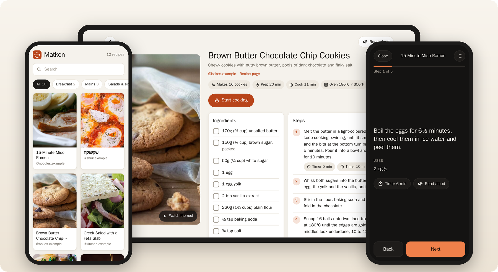
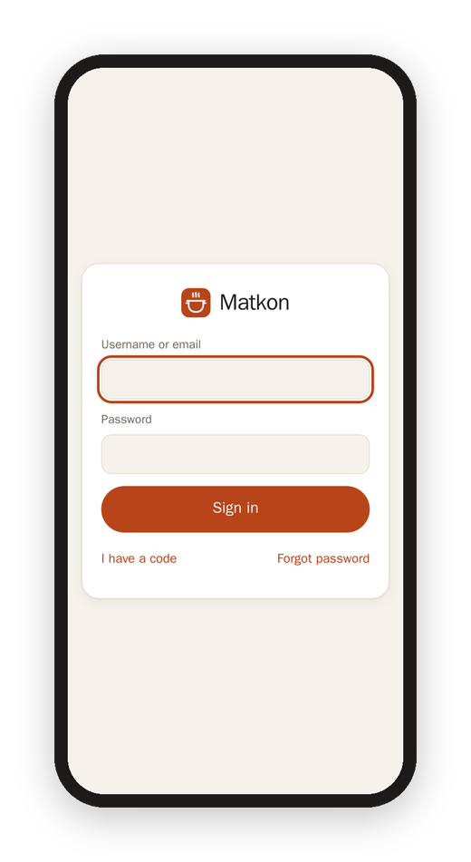

[Matkon docs](README.md) › Getting started

# What is Matkon?

Matkon (מתכון, Hebrew for "recipe") takes the cooking reels I save to my "Recipes" collection on Instagram and turns each one into a real recipe page: the ingredients with their amounts, the steps in order, the creator's tips, and the reel itself one tap away. I save a reel the way I always do, and the next time I'm on Instagram in my browser, it comes into Matkon, and into my Obsidian vault too.

*The home page, a recipe on a tablet, and cooking mode in the dark.*

## What it does

- **Brings the collection in on its own,** through a small extension in my browser, so I never send it anything, and Matkon itself never touches my Instagram account. See [The browser extension](browser-extension.md).
- **Writes down only what the reel gives.** If the creator never says how much flour, the page says "no amount" and lists it under "Not in the reel," instead of guessing. See [From reel to recipe](how-it-works.md).
- **Finds the real recipe** on the creator's blog or newsletter when the caption links one, since that's usually where the amounts are.
- **Cooking mode,** one step at a time, with that step's amounts right under it and timers. See [Cooking](cooking.md).
- **Remembers,** on every device: what you saved, made, rated and wrote down. See [Memory and history](memory-and-history.md).
- **Hebrew and English.** Hebrew reels stay in Hebrew, right to left, and each one also has an English version one tap away.
- **One kitchen for the whole house.** Everyone has their own account, and anyone can add their own Instagram collection to it. See [Accounts and invites](accounts-and-invites.md).

## Where you open it

Matkon is a web page, so it works on a phone, a tablet or a computer, in light or dark mode. Mine is at my own address, and it only opens for people with an account. On a phone, "Add to Home Screen" makes it open like an app.

## Signing in

Everyone signs in with a username (or their email) and a password, once on each device. It stays signed in for a year, unless the password changes, which signs that account out everywhere.

There's no open sign-up. I invite people by email, and they join with the code. See [Accounts and invites](accounts-and-invites.md).

Next: [Accounts and invites](accounts-and-invites.md)
